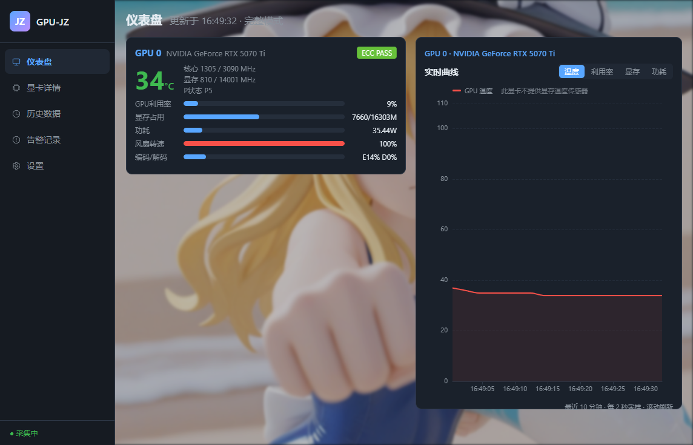
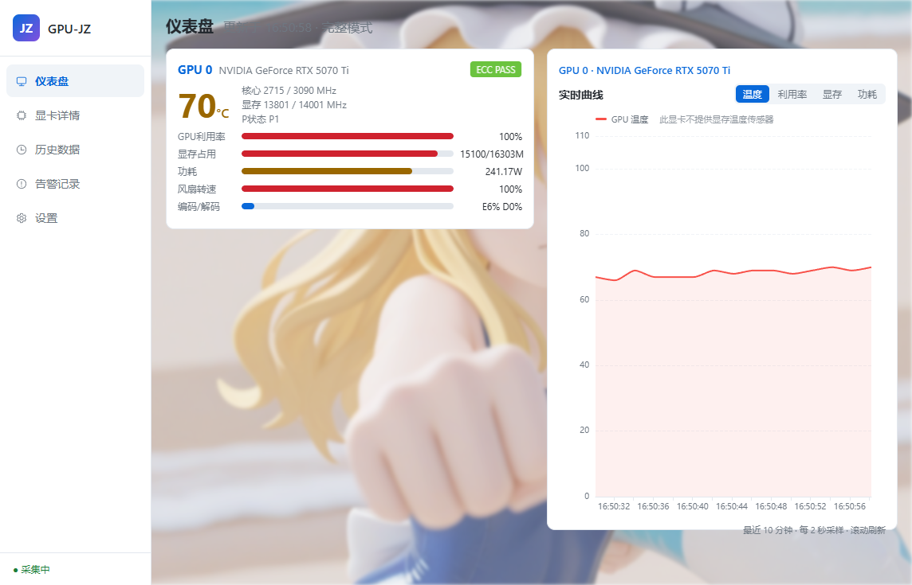

# GPU-JZ

> [!IMPORTANT]
> ## Fork 说明
> 本仓库 fork 自原作者 **[sertreet/GPU-J](https://github.com/sertreet/GPU-J)**（原作者：大白熊 / Bear，[memristor.cn](https://memristor.cn)）。
>
> - 原项目采用 **MIT 协议** 开源，允许自由使用、修改和再分发
> - 原仓库未公开源码（仅提供 Release 安装包），本仓库基于官方安装包 `Windows_GPU-J.Setup.0.0.1.exe` 提取的代码进行**重构与功能扩展**
> - 本项目源码为完整可构建的工程（electron-vite），非二次打包产物
> - 所有改动记录见 **[CHANGELOG.md](./CHANGELOG.md)**
> - 若原作者后续开源官方仓库，本仓库将同步跟进

GPU 状态与 ECC 错误实时监控工具。监控显卡温度、利用率、显存、功耗、风扇转速与 ECC 错误，支持多卡、历史数据留存与阈值告警。



## 功能

### 实时监控（多 GPU）

- GPU 利用率、显存利用率、编码器 / 解码器利用率
- GPU 温度、显存温度（显卡不支持时自动隐藏该曲线并提示）
- 显存已用 / 总量、核心与显存频率（当前 / 上限）
- 功耗、温度、风扇转速
- 性能状态 P-State、性能限制原因
- ECC 错误（4 类计数）与 Retired Pages 状态

### 仪表盘

- 左侧多卡卡片：温度主数值、利用率 / 显存 / 功耗 / 风扇 / 编解码进度条、ECC 徽章
- 右侧**实时曲线面板**：温度 / 利用率 / 显存 / 功耗四种指标一键切换，秒级滚动，悬停查看历史点

### 显卡详情

- 静态信息：型号、驱动版本、CUDA 版本、VBIOS、序列号、UUID、计算能力
- PCIe 链路：当前 / 最大 世代与宽度、实际带宽估算
- 功耗三档对比：当前 / 默认上限 / 最大上限
- **进程级占用**：按进程列出显存占用与 GPU 利用率，快速定位"谁在吃显存"

### 历史数据

- 每分钟聚合落盘，按天分文件（`JSONL` 明文，无数据库依赖）
- 按 GPU / 指标 / 日期范围查询，图表展示
- 一键**导出 CSV**（带 BOM，Excel 打开中文不乱码）
- 自动清理超过保留天数的数据

### 告警

- 阈值可配置：温度、显存占用、功耗，以及 ECC 错误增量
- 应用内弹窗提醒 + 告警记录表格
- 同一告警 60 秒冷却，避免刷屏

### 界面

- 三套主题：深色科技 / 浅色简洁 / 跟随系统，切换即时生效
- 自定义背景壁纸（透明度、模糊可调）



## 安装使用

前往 [Releases](../../releases) 下载（当前 [v0.1.2](https://github.com/cengshixin22-rgb/GPU-JZ/releases/tag/v0.1.2)）：

| 文件 | 说明 |
|------|------|
| `GPU-JZ-<version>-portable.exe` | 免安装便携版，双击即用 |
| `GPU-JZ.Setup.<version>.exe` | 安装版，带开始菜单与卸载程序 |

> 未做代码签名，首次运行 Windows SmartScreen 可能提示"已保护你的电脑"，点"更多信息 → 仍要运行"即可。

**环境要求**：NVIDIA 显卡 + 驱动（需 `nvidia-smi` 可用，建议 470 以上版本以支持扩展指标查询）。

## 从源码构建

```bash
# 安装依赖
npm install

# 开发模式
npm run dev

# 打包（Windows：安装版 + 便携版）
npm run build:win

# 其他平台
npm run build:linux
npm run build:mac
```

国内网络下载 Electron 较慢时可加镜像：

```bash
ELECTRON_MIRROR="https://npmmirror.com/mirrors/electron/" \
ELECTRON_BUILDER_BINARIES_MIRROR="https://npmmirror.com/mirrors/electron-builder-binaries/" \
npm run build:win
```

## 数据存放位置

| 内容 | 路径 |
|------|------|
| 设置 | `%APPDATA%/GPU-JZ/settings.json` |
| 历史数据 | `%APPDATA%/GPU-JZ/history/YYYY-MM-DD.jsonl` |
| 告警记录 | `%APPDATA%/GPU-JZ/history/alerts.jsonl` |

历史数据为纯文本，单卡约 3 MB / 月，可直接删除或迁移。

## 低占用设计

- 采集默认 2 秒一次，可在设置中调整；**窗口失焦自动降为 3 倍间隔**
- 历史数据每分钟只写 1 条聚合记录，无数据库、无常驻后台进程
- 实时曲线用固定长度环形缓冲（600 点），内存不随运行时长增长
- 图表渲染节流，ECharts 按需引入并独立分包

## 技术栈

Electron + electron-vite · Vue 3 · Element Plus · ECharts · nvidia-smi

## 原版界面（v0.0.1）

供对比参考，来自原项目 README：


## 已知限制

- 仅支持 NVIDIA 显卡（依赖 `nvidia-smi`），不支持 AMD / Intel
- 消费级显卡通常无显存温度传感器（`temperature.memory` 返回 `N/A`），此时该曲线自动隐藏
- 进程级占用依赖驱动上报，部分容器 / WSL 环境可能为空

## 协议

[MIT](./LICENSE) · 原项目版权归 [sertreet](https://github.com/sertreet) 所有
